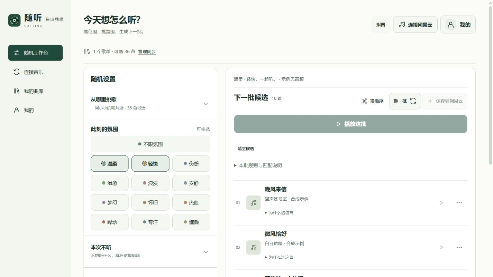
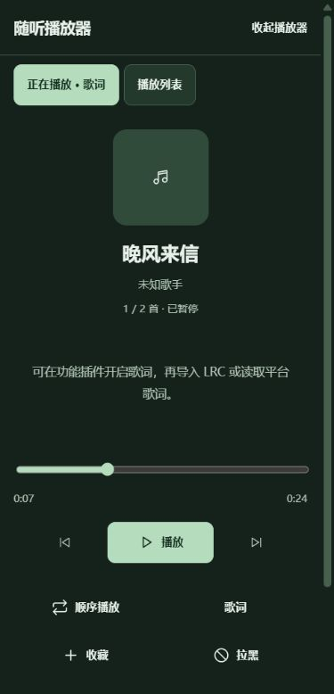

# 随听 · Sui Ting

**选一种心情，让熟悉的歌重新心动。**

随听是一款可以自己设定选歌规则的音乐播放器。导入本地音乐，或连接网易云歌单，选择想听的范围、氛围和歌曲数量，就能生成一批适合此刻的播放列表。

比如：从「我喜欢的音乐」里挑 20 首安静、治愈的歌，多听一些最近收藏的，并避开这几天已经在随听里听过的歌曲。

目前为 **0.1.4 公开预览补丁版**，提供 Android 应用源码和可在电脑上运行的浏览器预览。

[快速开始](#快速开始) · [第一次使用](#第一次使用) · [常见问题](#常见问题) · [开发与贡献](#开发与贡献)



以上为 0.1.4 实际网页界面，使用内置合成示例，不代表内置音乐授权。[查看补丁更新](docs/CHANGELOG-0.1.4.md)。

<details>
<summary>查看新版手机播放器（深色）</summary>



截图使用自制静音 WAV 演示本地播放，歌词在此收起；不包含第三方录音或真实账号资料。这是手机尺寸的网页界面截图，不是安卓通知栏或浮窗验收图。

</details>

### 0.1.4 小更新

- **更轻**：Android 预览包约 1.1 MB，保留本地音乐、随机核心、插件与原创彩蛋。
- **喜欢先记下来**：网易云红心先暂存本机，在「我的 → 喜欢同步」手动提交，或只核对、不写入。
- **队列接着听**：顺序队列自然播完从第一首继续；新生成的候选仍不会顶掉正在播放的列表。
- **通知更稳**：修复红心核对时操作位变化的问题，红心与桌面歌词命令分离；具体系统媒体卡片仍需真机验证。

[下载 0.1.4 Android 预览 APK](https://github.com/ztcxry/suiting/releases/download/v0.1.4-public/suiting-0.1.4-public-android.apk) · [0.1.4 版本与更新说明](https://github.com/ztcxry/suiting/releases/tag/v0.1.4-public)

## 随听能做什么

- **按心情选歌**：选择一个或多个歌单，再按氛围、风格、语言筛选。
- **调整新旧比例**：控制最近加入歌单的歌曲与较早歌曲在本批中的占比。
- **少一点重复**：避开近期在随听里听过的歌；支持单曲黑名单和歌手黑名单，包含署名合唱。
- **也能选不听什么**：「本次不听」多选风格、氛围和语言，硬排除优先；未分类歌曲可选择一并排除。
- **底部播放器**：点开查看歌词、当前列表、进度和音质；支持顺序、列表循环、单曲循环与随机。
- **不断歌地选下一批**：生成只更新候选；主动点「播放这批」才替换正在使用的播放列表。
- **彩蛋自主开关**：在「我的 → 功能插件与 DIY」手动开启「搜索彩蛋」，默认关闭，随时可关；使用原创动态唱片与小调，可临时换入自己的素材，不调高系统音量。
- **连接网易云**：同步歌单、查看日推，并把生成结果另存为一张网易云歌单。
- **喜欢暂存与核对**：网易云插件开启后，红心先按账号记入本机；显式同步后读回检查，不清空官方喜欢。
- **管理本地音乐**：导入普通音频、编辑分类与标签，支持 LRC / TXT 歌词和资料备份。

你可以在随听里直接听，也可以让随听负责选歌，再将结果保存到网易云中播放。

## 快速开始

### 在电脑上运行

需要安装 **Node.js 22 或更高版本**。第一次安装依赖需要联网。

**Windows 用户：**

1. 下载并解压项目，或使用 Git 克隆仓库。
2. 双击项目文件夹内的 `启动随听.cmd`。
3. 等待依赖安装和服务启动，浏览器会自动打开随听。

如果浏览器没有自动打开，手动访问 **<http://127.0.0.1:4392/>**。使用期间请保持启动窗口打开。

**使用命令行：**

```sh
git clone https://github.com/ztcxry/suiting.git
cd suiting
npm ci
npm start
```

看到启动成功的提示后，在浏览器访问 <http://127.0.0.1:4392/>。关闭终端或按 `Ctrl+C` 可以停止服务。

浏览器版是本机运行的预览，不需要部署网站。默认服务仅监听本机地址。

### 在 Android 上运行

支持 Android 8.0 及以上版本，可到 [GitHub Releases](https://github.com/ztcxry/suiting/releases) 获取预览 APK。需要自行构建时，请按照 [开发与构建说明](docs/DEVELOPMENT.md) 准备环境。

Android 版安装后可独立运行，不需要让电脑上的 Node.js 服务一直开着；通知栏、锁屏控制和悬浮歌词等能力以 Android 版为主。

## 第一次使用

第一次进入会弹出 **带上你的歌 → 选一种听法 → 开始听** 的简短指南。关闭后不再自动弹出，需要时点顶部「指南」重开，不占用工作台空间。

### 01 · 带上你的歌

两种方式任选一种，也可以同时使用。

**连接网易云音乐**

1. 点击首页的 **「连接网易云音乐」**，按提示开启连接。
2. 点击 **「生成登录二维码」**，用手机网易云音乐 App 扫码确认。
3. 在「我创建的」或「我收藏的」中找到歌单，点击旁边的 **「同步」**。
4. 同步完成后点击 **「去随机工作台」**。之后也可以通过导航中的「连接音乐」管理账号和歌单。

登录后没有看到歌单时，点击「读取我的歌单」。**登录成功只代表账号已连接，还需要选择歌单并同步。**

同步读取的是歌单和歌曲信息，不等于下载歌单里的音频，也不会改动原歌单。

**导入本地音乐**

点击首页的 **「导入本地音乐」**，选择电脑或手机中的普通音频文件。支持 MP3、FLAC、M4A、AAC、WAV、OGG、OPUS 等格式，能否播放还取决于设备和音频编码。

本地音频不上传、不转码，也不会修改原文件。`.ncm`、`.qmc` 等加密音乐不能直接播放。

### 02 · 选一种听法

在「随机工作台」中：

1. 展开 **「从哪里挑歌」**，选择歌单；「全部曲库」指已经导入或同步到随听的歌曲。
2. 选择氛围。不想限制时，保留「不限氛围」即可。
3. 设置 **「这次听几首」** 和 **「最近听过的」**。
4. 点击 **「生成随机队列」**。

第一次可以先选一个熟悉的歌单，保持不限氛围，生成 20 首试试。

想选得更细，可以展开「风格与语言」；近期歌曲比例、参考歌单、标签和分类选项放在「精细调频与分类」里。这些区域右侧都有「展开 / 收起」提示。

### 03 · 开始听

生成后，歌曲会出现在「下一批候选」中。点击 **「播放这批」**，或在已有播放列表时点击 **「替换播放列表并播放」**。底部播放条显示当前歌曲，点开查看完整播放器和歌词。

| 操作 | 会发生什么 |
| --- | --- |
| 生成随机队列 / 换一批 | 更新候选，不暂停、不替换当前播放列表 |
| 播放这批 / 替换播放列表并播放 | 明确交接候选并开始播放 |
| 清空候选 | 只清候选，不停止当前播放 |
| 换顺序 | 调整候选顺序，并移除被屏蔽或本次不听的歌曲 |
| 保存到网易云 | 经你确认后，新建一张网易云歌单，不覆盖原歌单 |
| 为什么选这首 | 展开查看这首歌入选的原因 |

修改设置后，点击「生成随机队列」或「换一批」重新选歌，当前播放始终不受生成影响。单曲／歌手黑名单会立即从播放列表排除；「本次不听」用于候选，不追溯打断已在听的列表。歌手规则优先使用平台 ID，旧资料和本地文件缺少 ID 时按完整署名匹配，不推断未署名的幕后参与。

开启「歌词与翻译」及「Android 桌面歌词」插件并手动授权悬浮窗后，可在完整播放器或下拉展开的系统媒体通知开关桌面歌词；歌词本身不放挡点击的常驻按钮。网易云插件开启时，平台曲目还可在通知中操作官方红心；本地歌曲不写入平台。不同系统卡片可能需要展开，仍需真机验证。

如果希望继续用网易云客户端听歌，点击「保存到网易云」，填写歌单名称和可见性，确认创建后在网易云中打开即可。

## 常见问题

### 输入 npm start 后打不开？

在项目目录执行命令并按回车，看到「随听已启动」后再打开地址，并保持启动窗口运行。`git clone` 提示目录已经存在时，进入已有项目即可；依赖的弃用／审计警告不等于启动失败。端口占用时按终端提示处理，不要盲目升级依赖或清除现有目录。

### 已经安装并登录网易云电脑版，还要在随听登录吗？

需要。随听是独立播放器，不会自动读取网易云客户端的登录状态，也不会接管客户端当前的播放队列。

### 为什么重新打开服务后要再次扫码？

浏览器版的网易云登录态只保留在本机服务内存中，服务重启后需要重新扫码。曲库清单、分类等资料保存在当前浏览器中。

建议始终使用同一个浏览器和地址打开随听；`localhost` 与 `127.0.0.1` 在浏览器中使用不同的本地存储。

### 「近期歌曲」是指刚发行的新歌吗？

这里主要指**最近加入歌单的歌曲**，默认参考近期 100 首。缺少添加时间时，可以按歌单顺序补足，页面会说明依据；这种情况不保证是真正最近加入的歌曲。

### 为什么筛选后歌曲很少，或者选出的歌不太符合氛围？

氛围和风格依赖已有分类、网易云百科辅助信息或手工标注，当前没有 AI 听音分类。可以尝试「补全分类」，或在曲库中编辑歌曲标签。

「智能宽松」会优先选精确匹配，再按设置补充相近或待分类歌曲；「严格」只选择精确标签。候选太少时，可以减少条件、调整冷却时间，或扩大选歌范围。「本批规则与匹配说明」会展示选歌结果的依据。

### 在网易云里刚听过的歌，随听也会避开吗？

不一定。冷却记录来自随听内的实际播放和手动「标记听过」，不包含网易云客户端的完整播放历史。只生成队列不会被记作听过。

### 「收藏」会修改网易云的红心吗？

「收藏到随听」只保存在本地；网易云歌曲的红心也先记入当前账号的本机待办，不立即联网写入。到「我的 → 喜欢同步」点「同步到网易云」才会提交；也可点「只核对，不写入」。本地音频不会被提交为网易云喜欢。

### 会员歌曲能播放吗？

平台歌曲的可播放范围取决于账号权限、会员、地区和版权。随听使用非官方适配接口，不绕过付费、试播或 DRM 限制，也不提供加密音乐解锁。

### 怎样备份自己的资料？

在「连接音乐」页面的资料区域导出 JSON 备份，可以保存曲库清单、分类、规则和黑名单等资料。**备份不包含音频文件、文件访问授权、账号凭据或待同步喜欢日志**，请另外保管原始音频。

浏览器版导入的音频副本保存在当前浏览器的 IndexedDB 中，清理站点数据可能将它们移除。Android 版保存所选文件的只读访问授权，文件移动或权限撤销后需要重新选择。

待同步喜欢日志与歌单备份分开保存，覆盖升级会保留，但卸载或清除应用／站点数据会丢失；清理前请先手动同步。网易云接口不提供逐首喜欢时间，只能核对随听本机的今日操作和上次检查以来远端新增，不能精确还原官方“今日新增”。

## 隐私与当前状态

网易云连接默认关闭，由用户主动开启。本地音频不会上传到平台，项目不包含广告、分析统计或遥测。详细的数据处理方式见 [隐私说明](PRIVACY.md)。

本项目仍处于公开预览阶段，Android 实机兼容性和真实账号端到端验证尚未完成。后台播放、桌面歌词与文件跨重启访问请以设备实测为准。当前不支持 QQ 音乐、任意脚本安装或 AI 听音分析。

0.1.4 通过 256 项 JavaScript／71 项 JVM 测试和 Android 构建；测试通过不等于没有安全问题。Node 运行时依赖审计仍报告 5 项高危告警，见 [本版验证与限制](docs/CHANGELOG-0.1.4.md#验证边界)。本地音乐和随机核心不要求开启联网插件。

## 开发与贡献

项目使用 JavaScript ES Modules；Android 播放使用原生 Media3 服务。修改前可先阅读 [贡献指南](CONTRIBUTING.md) 和 [架构说明](docs/ARCHITECTURE.md)。

```sh
npm ci
npm test
npm run check
npm start
```

- [开发与 Android 构建](docs/DEVELOPMENT.md)
- [插件与扩展开发](PLUGINS.md)
- [发布检查](docs/PUBLISHING.md)
- [图标资源说明](docs/ICON.md)

欢迎通过 Issue 反馈问题，通过 Pull Request 提交改进。反馈时请提供系统、浏览器或设备版本、复现步骤和报错信息，不要提交账号凭据或私密歌单内容。

## 项目来源与许可

本仓库基于 [ztcxry/suiting](https://github.com/ztcxry/suiting)，保留原项目的版权和许可声明，并持续改进使用流程与界面。

自有代码采用 [MIT License](LICENSE)，版权署名为 SuiTing contributors。第三方组件遵循各自许可，详见 [第三方说明](THIRD_PARTY_NOTICES.md)。音乐、歌词和其他第三方内容的使用权不包含在本项目许可证中。
